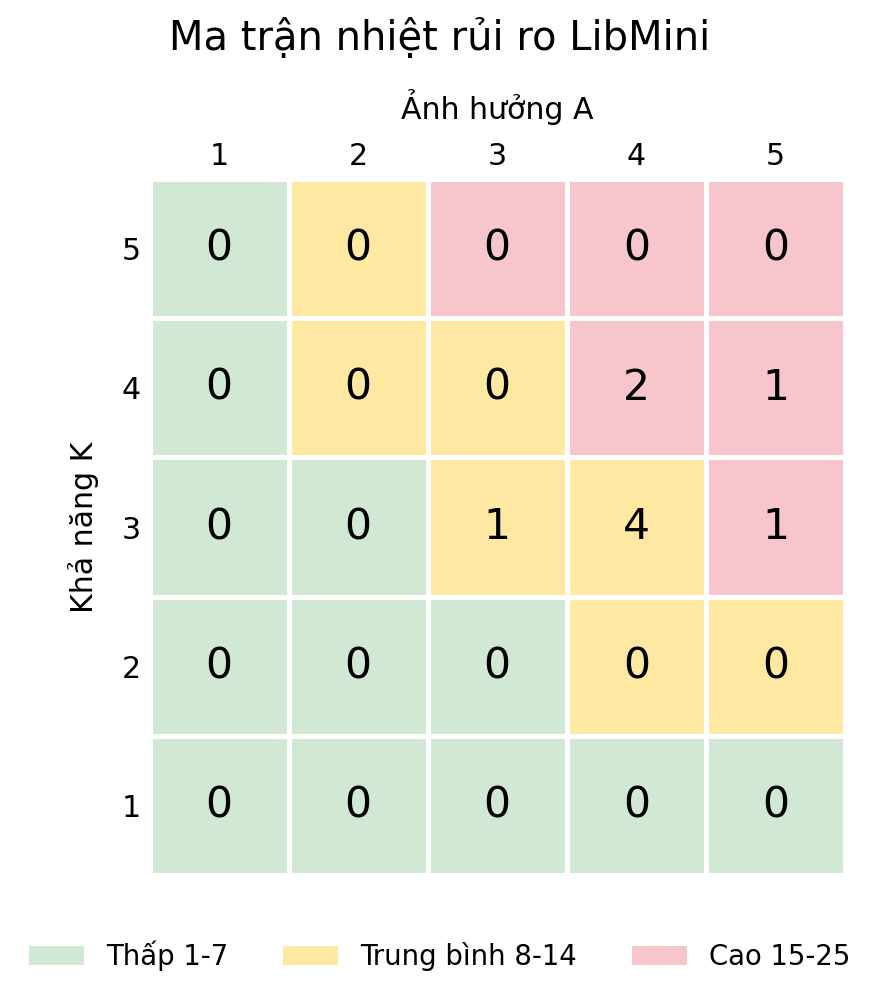

# Kế hoạch kiểm thử LibMini

Nhóm 3 - Lớp COMP130702 - 3 thành viên  
Nguyễn Tấn Lộc - 50.01.104.084
Đặng Trung Tín - 50.01.104.161
Lỡ Hoàng Nam - 49.01.104.092

## 1 Cơ sở và mục tiêu

Nhóm chọn hướng B để tự xây dựng LibMini và thực hiện quy trình kiểm thử từ đặc tả đến hồi quy. 

Mục tiêu là kiểm tra quyền truy cập, tính nhất quán của phiếu/tồn kho và phí quá hạn; truy vết ca tới yêu cầu; thực thi có minh chứng, ghi lỗi, retest và hồi quy. Không lấy kết quả của mã đang kiểm thử làm đáp án khi trái đặc tả đã duyệt.

## 2 Phạm vi trong và ngoài

| Mã | Chức năng trong phạm vi |
| --- | --- |
| LM01 | Đăng nhập, hết phiên và kiểm tra quyền độc giả/thủ thư. |
| LM02 | Tra cứu theo mã/tên; hiển thị đầu sách, bản sách và trạng thái. |
| LM03 | Mượn một bản; hạn mức độc giả, thẻ, phiếu quá hạn và tranh bản cuối. |
| LM04 | Gia hạn một lần, kiểm tra hạn trả, thẻ và cờ đặt trước. |
| LM05 | Trả sách, đổi trạng thái, cập nhật bản sách nguyên tử, chống trả lặp. |
| LM06 | Tính phí theo ngày quá hạn và trần; xem phí theo quyền. |

Ngoài phạm vi: hệ thống thư viện thật, thanh toán/ngân hàng, QR/RFID, đặt chỗ đầy đủ, quản lý sách mất/hỏng, nhập mua sách và kiểm thử tải quy mô lớn. Các phần này không cần để chứng minh kỹ thuật của học phần và vượt nguồn lực nhóm 3 người.

## 3 Quy mô và kết quả dự kiến

Dự kiến ít nhất 60 ca thủ công mức thấp cho 6 chức năng, RTM bao phủ 100% yêu cầu trong phạm vi; EP/BVA trên 4 trường; bảng quyết định và chuyển trạng thái; 2 hàm hộp trắng, ít nhất 15 unit test và 8 kịch bản UI/API. Bao phủ nhánh hai hàm chọn từ 80%. Mục tiêu 5 báo cáo lỗi có minh chứng nếu thực tế tìm đủ; không bịa lỗi để đạt số lượng.

## 4 Cách tiếp cận và kỹ thuật

Review đặc tả và đáp án trước khi chạy. Ưu tiên lỗi mượn đồng thời, vượt hạn mức và tính phí; sau đó gia hạn, phân quyền, tra cứu. Kiểm thử ở mức hàm, API và giao diện; mỗi lỗi sửa có retest và chọn ca hồi quy theo RTM.

| Đối tượng | Kỹ thuật và dữ liệu dự kiến |
| --- | --- |
| Tài khoản | EP/BVA: tên đăng nhập 5/6/20/21 ký tự, ký tự đầu và nhóm ký tự; mật khẩu 7/8/20/21, thiếu hoa/thường/số. |
| Hạn mức mượn | BVA với số bản đang giữ 0/2/3; thử thêm 1 bản để chạm/vượt trần 3. Bảng quyết định thẻ, quá hạn, hạn mức, bản sẵn sàng. |
| Gia hạn | Bảng quyết định; số lần 0/1, trước/đúng/sau ngày hạn; có/không cờ đặt trước. Gia hạn phải cộng 7 ngày vào hạn cũ. |
| Phí quá hạn | BVA δ=1 ngày: 0/1 và 49/50/51; phí tương ứng 0/2.000 và 98.000/100.000/100.000 đồng. Ngày âm, số lẻ, không phải số bị từ chối ở hàm. |
| Trạng thái và đồng thời | Sẵn sàng - đang mượn - trả; đang mượn - quá hạn - đã trả. Hai yêu cầu tranh bản cuối, hai bản khác tranh hạn mức, gửi trả lặp. |
| Hộp trắng và thăm dò | CFG, V(G) hai cách, đường cơ sở cho can_borrow và calculate_late_fee; MC/DC với điều kiện ghép, vòng lặp nếu có. Ít nhất 2 phiên thăm dò có điều lệ. |

## 5 Môi trường và dữ liệu

Dự kiến Python 3.11+, SQLite, API HTTP và web cục bộ; unittest/coverage.py, Playwright, GitHub Actions/Issues. Ghi phiên bản OS, trình duyệt, công cụ và commit cho mỗi lần chạy. Dùng giao dịch CSDL để bảo vệ mượn/trả; kiểm thử đồng thời ở lớp dịch vụ/CSDL và API.

Seed gồm 2 độc giả hợp lệ, 1 thẻ hết hiệu lực, 1 thủ thư; đầu sách có nhiều bản, bản cuối sẵn sàng, độc giả giữ 2/3 bản, phiếu đến hạn/quá hạn, đã gia hạn và cờ đặt trước. Mỗi ca reset hoặc dùng CSDL riêng. Dùng đồng hồ giả lập, mốc ngày Asia/Ho_Chi_Minh, dữ liệu giả lập; không dùng thông tin độc giả thật.

## 6 Tiêu chí đầu vào và đầu ra

| Loại | Điều kiện kiểm chứng được |
| --- | --- |
| Đầu vào 1 | B01-B08 đã có quyết định cho luồng sắp chạy; đặc tả có phiên bản. Không chạy ca phụ thuộc quy tắc chưa được thống nhất. |
| Đầu vào 2 | Build cài được, có commit; smoke 10 ca trọng yếu đạt 10/10 trước đợt kiểm thử. |
| Đầu vào 3 | Seed và reset thành công ít nhất 1 lần; vai trò, bản cuối, hạn mức 2/3 và các mốc ngày sẵn sàng. |
| Đầu vào 4 | 100% ca của đợt có mã yêu cầu, dữ liệu, bước, mong đợi, người chạy và người review. |
| Đầu ra 1 | 100% ca đã duyệt trong đợt có actual, trạng thái và minh chứng; không còn Not Run/Blocked khi đề nghị kết thúc. |
| Đầu ra 2 | Ít nhất 95% ca đã duyệt đạt Pass; 100% ca ưu tiên cao về đồng thời, phí và phân quyền đạt. Mẫu số là toàn bộ ca của đợt đã duyệt. |
| Đầu ra 3 | Không còn Critical/High mở; mọi lỗi thấp hơn có người xử lý, hạn và chấp thuận rủi ro của đại diện nhóm/người duyệt. |
| Đầu ra 4 | RTM đạt 100% yêu cầu trong phạm vi; đủ 60 ca, 15 unit, 8 UI/API; bao phủ nhánh hai hàm từ 80%. |
| Đầu ra 5 | Có retest và hồi quy sau ít nhất 1 thay đổi; log, issue, RTM, báo cáo, slide, video, AI và đóng góp được lưu đúng phiên bản. |

## 7 Tạm dừng và quản lý lỗi

Tạm dừng luồng bị ảnh hưởng nếu build không chạy, reset sai hoặc CSDL không nhất quán. Ghi Blocked cùng nguyên nhân; chỉ tiếp tục sau khi sửa, reset và smoke đạt. Không đổi ca bị chặn thành Pass.

Issue có mã, tiêu đề, build, môi trường, yêu cầu, tiền điều kiện, dữ liệu, bước, mong đợi, thực tế, severity, priority và ảnh/log. Theo dõi New → Confirmed → Fixed → Retest → Closed; mở lại khi lỗi còn. Lỗi nghiêm trọng có 5 Whys. Lỗi cài có chủ đích phải gắn nhãn riêng, không gọi là lỗi tự nhiên.

## 8 Phân tích rủi ro LibMini

K là khả năng, A là ảnh hưởng, thang 1-5; điểm K×A. Cao 15-25, trung bình 8-14, thấp 1-7. Điểm là nhận định dự kiến theo mức phức tạp và hậu quả, chưa phải thống kê. SP là sản phẩm; DA là dự án.

| Mã | Loại | Rủi ro | K | A | K×A | Ứng phó |
| --- | --- | --- | --- | --- | --- | --- |
| LR01 | SP | Hai yêu cầu cùng mượn một bản sách cuối | 4 | 5 | 20 | Thử đồng thời trên cùng copy_id; đúng một phiếu mới, một người bị từ chối. |
| LR02 | SP | Mượn đồng thời làm vượt giới hạn 3 bản | 4 | 4 | 16 | Độc giả đang giữ 2 bản, mượn 2 bản khác đồng thời; tối đa thêm 1 bản. |
| LR03 | SP | Đếm ngày hoặc chặn trần phí quá hạn sai | 4 | 4 | 16 | BVA ngày 0/1, 49/50/51; đối chiếu lịch địa phương và công thức phí. |
| LR05 | SP | Độc giả đọc hoặc sửa phiếu người khác | 3 | 5 | 15 | Kiểm thử quyền tại API với hai độc giả và thủ thư; không chỉ ẩn nút. |
| LR04 | SP | Gia hạn sai điều kiện hoặc quá một lần | 3 | 4 | 12 | Bảng quyết định và chuyển trạng thái; thử sát hạn, quá hạn, có đặt trước. |
| LR06 | SP | Trả lặp làm tăng tồn kho hoặc ghi phí hai lần | 3 | 4 | 12 | Gửi lại cùng yêu cầu trả; trạng thái, tồn kho và phí không đổi lần hai. |
| LR07 | DA | Nhóm hiểu khác quy tắc mượn và tính phí | 3 | 4 | 12 | Chốt B01-B08 với giảng viên; quản lý phiên bản và cập nhật RTM. |
| LR08 | DA | UI hoặc CI chưa chạy được ở mốc tiến độ | 3 | 4 | 12 | Dựng smoke và CI sớm; chạy trên máy thứ hai trước Buổi 9. |
| LR09 | DA | Một người vắng làm dồn việc kiểm thử và video | 3 | 3 | 9 | Review vòng TV1-TV2-TV3; hướng dẫn chạy chung và quay thử sớm. |

LR01 được kiểm thử sớm nhất vì có thể cho hai người mượn cùng một bản. LR02/LR03 cùng 16 điểm, cần kiểm tra giới hạn độc giả và tính tiền trước các ca hiển thị. Rủi ro dự án được xử lý bằng chốt quy tắc, chuẩn bị môi trường và bàn giao, không chỉ bằng viết thêm test case.

## 8.1 Ma trận nhiệt rủi ro LibMini

Hàng là K, cột là A. Số trong ô là số rủi ro có cùng cặp điểm; màu theo tích K×A của vị trí, không theo số lượng trong ô. Ma trận được tạo từ đúng 9 rủi ro ở mục 8.

Tổng 9 rủi ro: 4 cao, 5 trung bình, 0 thấp. Ô K=4, A=5 có LR01; K=4, A=4 có LR02/LR03; K=3, A=5 có LR05; K=3, A=4 có LR04/LR06/LR07/LR08; K=3, A=3 có LR09.

Khi có đặc tả được duyệt hoặc kết quả chạy, nhóm rà lại điểm và ưu tiên, cập nhật cả bảng lẫn ma trận. Giữ phiên bản cũ để giải thích thay đổi ưu tiên trong báo cáo cuối kỳ.

## 9 Ước lượng ba điểm cho ba công việc chính

Đơn vị giờ công. a là lạc quan, m là khả dĩ nhất, b là bi quan. E=(a+4m+b)/6; SD=(b−a)/6. Các số là giả định kế hoạch, không phải thời gian đã thực hiện.

| Công việc | a | m | b | E | SD |
| --- | --- | --- | --- | --- | --- |
| Xây dựng nguyên mẫu, môi trường và dữ liệu | 16 | 24 | 40 | 25.33 | 4.00 |
| Thiết kế ca, thực thi, ghi lỗi và retest | 16 | 24 | 40 | 25.33 | 4.00 |
| Hoàn thiện báo cáo, slide và video | 8 | 12 | 22 | 13.00 | 2.33 |

Tổng E ≈ 63,67 giờ công. Nếu ba thời lượng độc lập, SD tổng = √[4² + 4² + (14/6)²] ≈ 6,12 giờ công. Báo cáo: khoảng 63,67 ± 6,12 giờ công ở mức ±1 SD. Đây không phải khoảng tin cậy 95% hay thời gian lịch khi ba người làm song song. Cập nhật sau khi chốt B01-B08 và chạy build đầu tiên.

## 10 Phân công nhóm ba thành viên

| TV | Việc và cách thực hiện | Sản phẩm |
| --- | --- | --- |
| TV1 | Điều phối, đặc tả và RTM; xây dựng/kiểm thử tài khoản, tra cứu; 20 ca LM01-LM02; review TV2. | Kế hoạch, đặc tả, RTM, 20 ca, log/issue; báo cáo và video phần mình. |
| TV2 | Xây dựng/kiểm thử mượn, gia hạn; 24 ca LM03-LM04; CFG can_borrow và 8 unit test; review TV3. | 24 ca, CFG/V(G), unit test, log/issue; báo cáo và video phần mình. |
| TV3 | Xây dựng/kiểm thử trả, phí; 16 ca LM05-LM06; CFG tính phí, 7 unit test; khung UI/API và CI; review TV1. | 16 ca, CFG/V(G), unit test, script/workflow; báo cáo và video phần mình. |

20 + 24 + 16 = 60 ca thủ công; 8 + 7 = 15 unit test. Bộ 8 UI/API được quản lý riêng, không cộng lặp để đủ 60 ca. TV1/TV2 cùng viết kịch bản thuộc chức năng mình; TV3 tích hợp CI. Mỗi người có commit, issue, phần video và phản tư thật. Tỷ lệ đóng góp chỉ điền theo thực tế, không ấn định trước.

## 11 Lịch đến hạn nộp

| Mốc | Sản phẩm cần hoàn thành | Người chính |
| --- | --- | --- |
| Trước Buổi 4 | Phiếu chính LibMini/dự phòng ExpenseMini trên LMS; kế hoạch nháp và ảnh ma trận trên GitHub. | TV1, cả nhóm |
| Trong 3 ngày phản hồi | Theo dõi duyệt, xác nhận không trùng; sửa phạm vi và chốt B01-B08. Nếu đã duyệt đề tài cũ, xin chấp thuận đổi trước Buổi 7. | TV1 |
| Buổi 4-6 | Đặc tả, build đầu, seed/reset, ca vòng 1, RTM và các issue đầu tiên. | Cả nhóm |
| Buổi 7 | Kế hoạch PDF, đặc tả, ít nhất 30/60 ca mức thấp và RTM sơ bộ. | TV1 |
| Buổi 7-8 | Hoàn thiện hộp đen, 2 hàm hộp trắng, đường cơ sở và kiểm thử thăm dò. | TV2-TV3 |
| Buổi 9 | 15 unit test, số liệu bao phủ và CI chạy trên kho thật. | TV3, cả nhóm |
| Buổi 10 | 8 UI/API, retest/hồi quy, báo cáo, slide và video đủ ba người. | Cả nhóm |
| Hạn cuối | 23:59, bảy ngày sau Buổi 10: nộp gói hồ sơ, link GitHub/video xem được. | Đại diện nhóm |

## 12 Hồ sơ bàn giao và phê duyệt

Cuối kỳ: báo cáo 25-40 trang nội dung chính (PDF và nguồn), 15-25 slide có notes 50-150 từ/slide, video 8-12 phút đủ thành viên, Excel kiểm thử, kho GitHub có README/CI/issues, phụ lục AI có ít nhất 2 ví dụ AI sai/thiếu, bảng đóng góp, đánh giá chéo và phản tư. Tệp nén: COMP1307_Nhom3_LibMini.zip.

Người soạn: Đặng Trung Tín . Người review: Lỡ Hoàng Nam . Đại diện nhóm: Nguyễn Tấn Lộc. Giảng viên duyệt: Lê Thanh Thoại. Chưa có ngày Buổi 10 nên chưa tự đặt ngày dương lịch; cập nhật theo LMS. Đề tài và điều chỉnh nghiệp vụ chỉ được coi là chốt sau xác nhận.

## 13 Các quy tắc nghiệp vụ cần duyệt

Quy tắc LibMini dưới đây do nhóm đề xuất để tạo cơ sở kiểm thử. Hướng dẫn của thầy gợi ý đề tài thư viện nhưng không quy định hạn mức hay mức phí cụ thể. Tất cả B01-B08 phải được thống nhất, phê duyệt và ghi phiên bản trước khi dùng làm đáp án kiểm thử chính thức.

| Mã | Nội dung | Giá trị đề xuất chờ duyệt |
| --- | --- | --- |
| B01 | Tài khoản | Tên đăng nhập 6-20 ký tự, bắt đầu bằng chữ; mật khẩu 8-20 có hoa/thường/số. Hai vai trò; phiên nhàn rỗi 30 phút. |
| B02 | Tra cứu | Tách đầu sách/bản sách; mã khớp chính xác, tên chứa chuỗi; không phân biệt hoa thường, có dấu. |
| B03 | Mượn | Mỗi yêu cầu 1 bản; thẻ hợp lệ, không có phiếu quá hạn, đang giữ dưới 3 bản, bản sẵn sàng. |
| B04 | Ngày hạn | Hạn trả = ngày mượn +14; ngày lịch Asia/Ho_Chi_Minh; đúng ngày hạn không phạt. |
| B05 | Gia hạn | Tối đa 1 lần, cộng 7 vào hạn cũ; chưa quá hạn, thẻ hợp lệ, không có cờ đặt trước. |
| B06 | Trả | Thủ thư xác nhận; phiếu/tồn kho/phí cập nhật nhất quán; gửi lại không xử lý thêm lần nữa. |
| B07 | Phí | max(0, ngày trả - ngày hạn) × 2.000 đồng; tối đa 100.000 đồng/phiếu. Hàm chỉ nhận ngày nguyên không âm. |
| B08 | Phân quyền | Độc giả chỉ xem và gia hạn phiếu mình; thủ thư lập mượn/xác nhận trả; kiểm tra tại API. |
